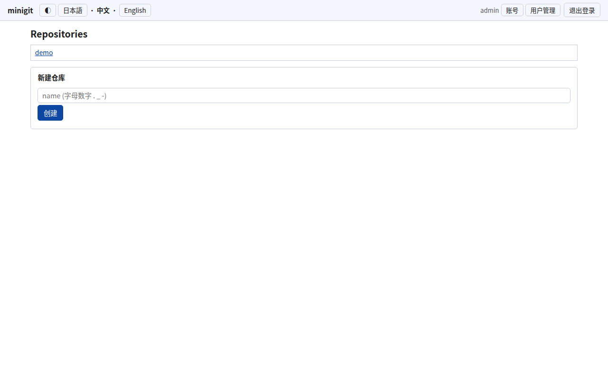

# minigit

[English](README.md) | [日本語](README.ja.md) | [中文](README.zh.md)

面向内网/离线环境的最小 Git 托管服务器。只依赖 Python 标准库和 git 命令行，
无需第三方包，也无需数据库服务器。



## 功能

- 通过 HTTP clone / push，带用户账号体系（SQLite，PBKDF2-SHA256 密码）
- Issue 与 Pull Request：左右分栏或行内合并的 diff、单词级高亮、
  浏览器内解决冲突（需 git 2.38+）
- 分支创建/删除、受保护分支、在线编辑并提交
- 自研语法高亮（py/java/js/c/sh/sql/html/css/ini），不依赖 JS
- 浅色 / 深色主题
- 界面支持 English、日本語、中文，见[语言](#语言)
- 单文件自解压分发（`pack.py` + `split.sh`），见[带入离线环境](#带入离线环境)

## 运行环境

- Python 3.8 及以上
- git 2.x（浏览器内解决冲突需 git 2.38 及以上）

## 启动

```sh
./run.sh            # http://localhost:8080/
./run.sh 9000       # 指定端口
```

首次启动会创建 `admin` 用户并生成随机密码，打印在控制台。
仓库和数据库存放在 `./repos`。

环境变量：

| 变量 | 含义 | 默认值 |
|---|---|---|
| `MINIGIT_ROOT` | 仓库与数据库存放目录 | `./repos` |
| `MINIGIT_USERS` | 首次启动时导入的用户 `alice:pw1,bob:pw2`（第一个为管理员） | 无 |
| `MINIGIT_GIT` | git 可执行文件路径 | 自动检测 |
| `MINIGIT_HOST` | 监听地址 | 全部 IPv4 与 IPv6 |
| `MINIGIT_LANG` | 界面语言的最终回退值（`en` / `ja` / `zh`） | `en` |
| `MINIGIT_DEBUG` | 设为 `1` 时打印每条 git 命令 | 关闭 |

忘记密码：`python3 minigit.py passwd 用户名 新密码`

## 配合 git 使用

```sh
git clone http://用户名:密码@localhost:8080/仓库名.git
```

## 语言

界面支持英语、日语、简体中文。文案存放在与 `minigit.py` 同目录的
`minigit_en.json` / `minigit_ja.json` / `minigit_zh.json` 中。
语言按以下顺序选择：

1. URL 参数 `?lang=en|ja|zh`（同时写入 Cookie）
2. 上次访问留下的 `mg_lang` Cookie
3. 浏览器的 `Accept-Language` 头
4. `MINIGIT_LANG`，未设置则为 `en`

每个页面的顶栏都有语言切换入口。缺失的键会依次回退到英语、日语。
新增语言只需复制一份 JSON、翻译其中的值、重启服务。
键值是不含 `{...}` 的纯文本，可以只翻译 JSON 而不改代码。

`extract.py` 是把文案从 `minigit.py` 抽取到 JSON 的代码改造工具，
仅供开发使用，运行服务并不需要它。


## 带入离线环境

可以把服务器带入只有 Python 和 cmd.exe（无 PowerShell）的 Windows 机器。
`pack.py` 将 `minigit.py` 与三个语言文件打包成一个纯 ASCII 自解压文件
`minigit_packed.py`，`split.sh` 将其切分为每个小于 20 KB 的分片。

```
[Mac/Linux]  python3 pack.py  ->  ./split.sh minigit_packed.py 19
[传输]       minigit_packed.py.part.*、minigit_packed.py.sha256、join.cmd、unpack.py
[Windows]    join.cmd minigit_packed.py  ->  python minigit_packed.py 8080
                                        ->  python unpack.py   （还原全部源码）
```

| 文件 | 用途 |
|---|---|
| `minigit.py` | 服务器本体 |
| `minigit_<lang>.json` | 各语言界面文案 |
| `run.sh` | Mac / Linux 启动脚本 |
| `pack.py` / `unpack.py` | 生成自解压包（bz2 + base85）/ 按 SHA256 校验还原全部源码 |
| `split.sh` / `join.sh` | 分片与合并（Mac / Linux） |
| `split.cmd` / `join.cmd` | 分片与合并（仅 Windows cmd） |

## 结构

服务器运行只需要 `minigit.py` 和三个 JSON 文件。
`schema.sql` 只是演示仓库用到的样例文件。

## 许可证

MIT
